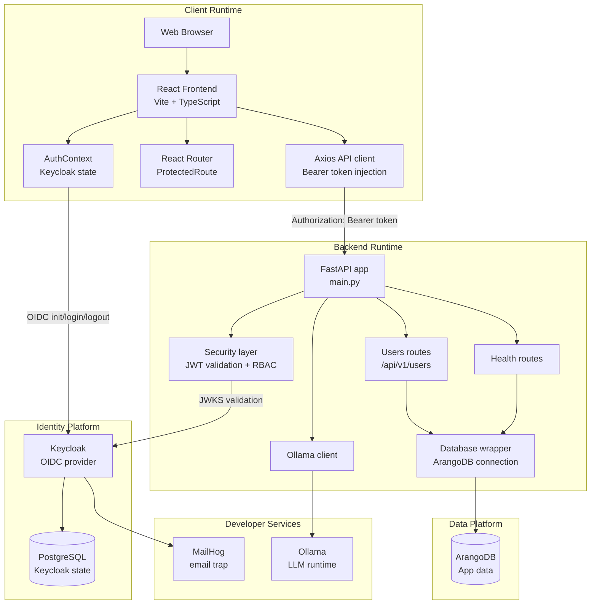

# Component Diagram

## Runtime component view

## Key responsibilities by component

### Frontend
- Renders the user experience
- Handles auth state through `AuthContext`
- Protects routes using `ProtectedRoute`
- Adds bearer tokens to API calls

### API backend
- Exposes the application surface area
- Performs token verification and permission checks
- Downloads or loads persistence data
- Coordinates AI calls and health checks

### Identity
- Centralizes authentication decisions
- Issues tokens and manages realm roles
- Persists user metadata and authentication state

### Data layer
- Stores the application’s strategic and user data in ArangoDB
- Stores Keycloak persistence in PostgreSQL

### Supporting services
- MailHog supports development email testing
- Ollama provides local LLM inference for AI-related features

## Dependency boundaries

- The browser never talks directly to ArangoDB.
- The frontend never writes database state directly.
- The backend is the only application component that accesses the app datastore.
- Keycloak sits outside the application domain but underpins trust and authorization.
