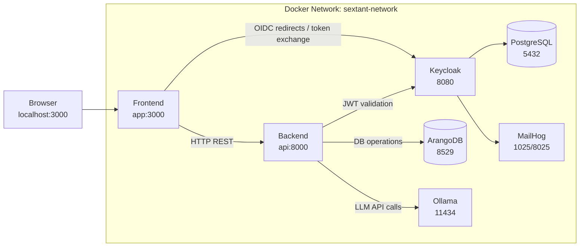
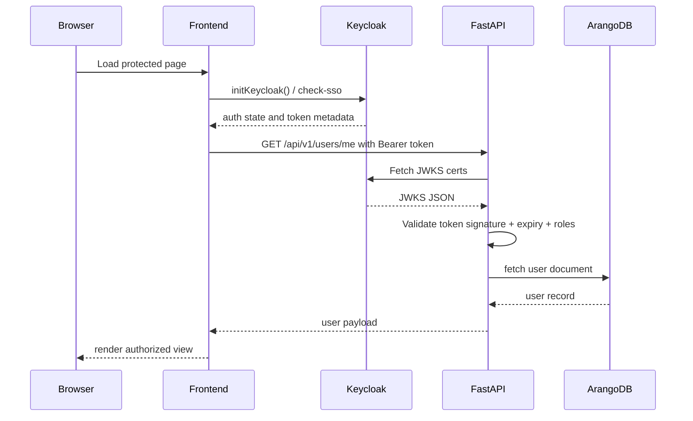
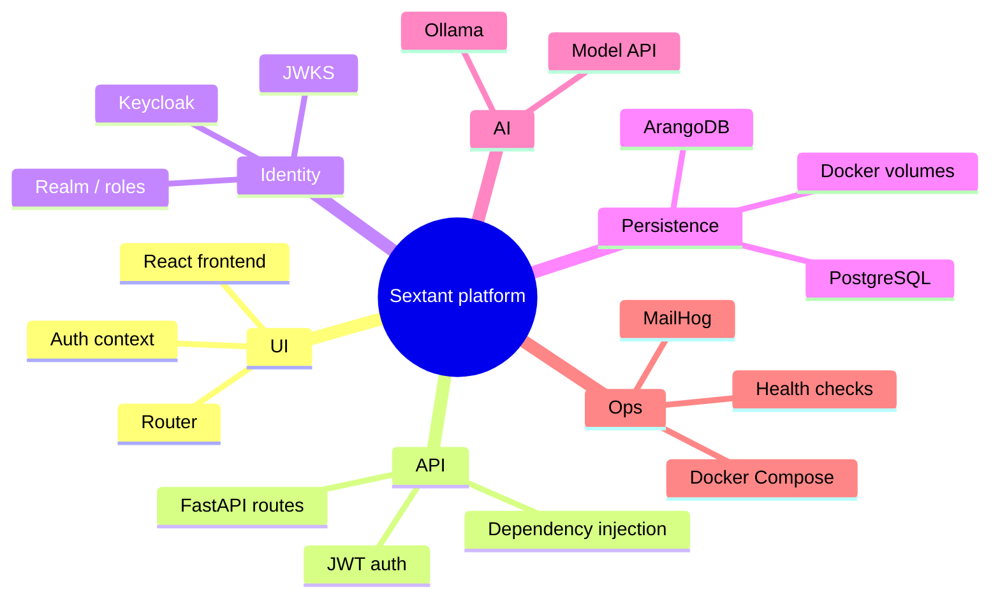

# Integration Map

## Overview

This integration map captures the concrete connections and runtime contracts between the platform services in the repository.

## Network topology

## Integration relationship matrix

| Source | Destination | Protocol | Purpose |
| --- | --- | --- | --- |
| Browser | Frontend | HTTP | Load app, navigate pages |
| Frontend | Keycloak | OIDC | Login, token issuance, SSO check |
| Frontend | API | HTTP/JSON + Bearer token | API access |
| API | Keycloak | HTTPS/HTTP + JWKS | JWT validation |
| API | ArangoDB | HTTP client | Data reads/writes |
| API | Ollama | HTTP JSON | LLM generation and model metadata |
| Keycloak | PostgreSQL | JDBC | Identity persistence |
| Keycloak | MailHog | SMTP | Local email delivery |

## Authentication and authorization boundaries

## API boundaries

### Frontend-facing UI boundary
The frontend consumes the API through a single Axios client abstraction in [app/src/services/api.ts](../../app/src/services/api.ts). This client:
- adds the current token to every request,
- retries after token refresh when a 401 occurs,
- exposes typed helpers for the route layer.

### Backend application boundary
The API is organized around route modules:
- [api/app/routes/users.py](../../api/app/routes/users.py)
- [api/app/routes/health.py](../../api/app/routes/health.py)

Important route contracts:
- `GET /health` - health and database status
- `GET /health/ready` - readiness
- `GET /health/live` - liveness
- `GET /api/v1/users/me` - current user
- `GET /api/v1/users/{user_id}` - fetch user by id
- `PUT /api/v1/users/{user_id}` - update user profile

### External identity boundary
The Keycloak integration is set up in:
- [app/src/services/keycloak.ts](../../app/src/services/keycloak.ts)
- [api/app/core/security.py](../../api/app/core/security.py)

This boundary governs:
- login initiation,
- redirect handling,
- PKCE flow,
- JWT verification,
- role extraction from token claims.

### Data boundary
The data boundary is encapsulated in:
- [api/app/core/database.py](../../api/app/core/database.py)

This abstraction centralizes:
- ArangoDB connection creation,
- per-collection access,
- singleton database reuse,
- application-level database access via dependency injection.

## Operational boundaries

## Summary

The system is intentionally layered and service-oriented. Browser traffic is isolated from persistence, identity is centralized in Keycloak, and domain logic stays behind the FastAPI boundary. This creates a clear API surface that is easy to reason about and extend without placing direct database or identity concerns into the frontend.
