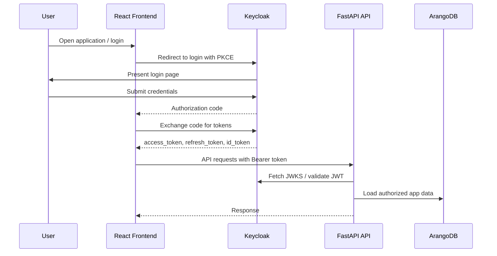
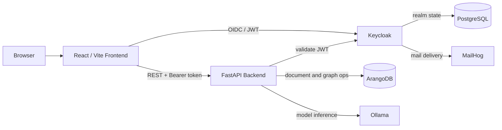

# System Overview

## Purpose

Sextant is a full-stack strategy navigation platform with a React frontend, a Python FastAPI API, and external identity and data services. The system is designed to support authenticated user access, strategy-oriented domain data, and optional AI assistance through an LLM service.

## Major components

### 1. Frontend application

The frontend is a React + TypeScript single-page application served by Vite. It provides the browser-facing experience, route navigation, and OIDC authentication flow via Keycloak.

Core implementation:
- [app/src/App.tsx](../../app/src/App.tsx)
- [app/src/context/AuthContext.tsx](../../app/src/context/AuthContext.tsx)
- [app/src/services/keycloak.ts](../../app/src/services/keycloak.ts)
- [app/src/services/api.ts](../../app/src/services/api.ts)

### 2. API backend

The backend is a FastAPI service that exposes business APIs, validates JWT bearer tokens, and coordinates access to the application data store.

Core implementation:
- [api/app/main.py](../../api/app/main.py)
- [api/app/core/security.py](../../api/app/core/security.py)
- [api/app/core/database.py](../../api/app/core/database.py)
- [api/app/routes/users.py](../../api/app/routes/users.py)
- [api/app/routes/health.py](../../api/app/routes/health.py)

### 3. Identity provider

Keycloak is the system of record for user identity, login, realm configuration, and token issuing. The frontend uses OIDC with PKCE, while the backend validates token signatures and claims.

Core implementation:
- [docker-compose.yml](../../docker-compose.yml)
- [infra/keycloak/realm-config.json](../../infra/keycloak/realm-config.json)
- [docs/specs/OIDC-FLOW.md](../specs/OIDC-FLOW.md)
- [docs/security-config.md](../security-config.md)

### 4. Application datastore

ArangoDB stores domain records and application data, including user-related records and graph-oriented data structures. The backend instantiates a singleton ArangoDB client and uses document collections for application data.

Core implementation:
- [api/app/core/database.py](../../api/app/core/database.py)
- [docker-compose.yml](../../docker-compose.yml)

### 5. Supporting infrastructure services

The platform also includes a PostgreSQL instance for Keycloak persistence, MailHog for local email capture, and Ollama for local LLM access.

## Services

| Service | Type | Role | Runtime exposure |
| --- | --- | --- | --- |
| `app` | React frontend | Browser UI | http://localhost:3000 |
| `api` | FastAPI backend | REST API and auth validation | http://localhost:8000 |
| `keycloak` | OIDC provider | Identity and token issuance | http://localhost:8080 |
| `postgres` | RDBMS | Keycloak persistence | localhost:5432 |
| `arangodb` | Graph/document database | App data persistence | http://localhost:8529 |
| `mailhog` | SMTP/email trap | Local email testing | 1025/8025 |
| `ollama` | LLM runtime | Local AI model endpoint | http://localhost:11434 |

## Datastores

### ArangoDB
- Primary datastore for application data.
- Used via the `ArangoClient` wrapper in [api/app/core/database.py](../../api/app/core/database.py).
- Database name is configured with `DATABASE_NAME` and environment variables.

### PostgreSQL
- Used only by Keycloak for identity storage.
- Configured in [docker-compose.yml](../../docker-compose.yml) with the `keycloak` database.

### Runtime volumes
- Persistent named Docker volumes maintain application data for Keycloak, PostgreSQL, ArangoDB, and Ollama.

## External dependencies

External dependencies include:
- Keycloak as the identity provider and OIDC issuer.
- PostgreSQL backing the Keycloak realm state.
- ArangoDB for graph/document application data.
- Ollama for LLM inference.
- MailHog for development-time outbound mail capture.
- Docker Compose as the application orchestration layer.

## Integration points

### Browser to frontend
- The browser loads the React app from the frontend service.
- React Router handles navigation between login and protected pages.

### Frontend to Keycloak
- The frontend initializes Keycloak with the configured realm and client ID.
- Login is performed through Keycloak OIDC protocol with PKCE.

### Frontend to backend API
- The frontend uses Axios with bearer token injection via [app/src/services/api.ts](../../app/src/services/api.ts).
- API requests are sent to the FastAPI service over HTTP.

### Backend to Keycloak
- The backend fetches JWKS from the Keycloak cert endpoint to validate JWTs.
- It reads realm and client claims to determine user roles.

### Backend to ArangoDB
- The backend connects to ArangoDB through the database wrapper and executes collection/document operations.

### Backend to Ollama
- The AI client is implemented in [api/app/services/ollama_client.py](../../api/app/services/ollama_client.py) and communicates with the local Ollama HTTP API.

### Keycloak to PostgreSQL
- Keycloak persists its realm data in PostgreSQL.

### Keycloak to MailHog
- MailHog is used for development email delivery and testing of identity workflows.

## Authentication flows

### OIDC login flow

### Token validation pattern

- The frontend stores the access token and uses it on API calls.
- The backend extracts the token from the `Authorization: Bearer ...` header.
- JWT validation uses the Keycloak public keys and checks expiration and issuer-related claims.
- The token is mapped to a `User` model with roles and identity.

## API boundaries

### Public frontend routes
- `/login`
- `/dashboard`
- `/profile`
- `/home`

### API boundaries exposed by backend

#### Health and operational endpoints
- `GET /health`
- `GET /health/ready`
- `GET /health/live`
- `GET /`
- `GET /version`

#### User endpoints
- `GET /api/v1/users/me`
- `GET /api/v1/users/{user_id}`
- `PUT /api/v1/users/{user_id}`

#### Auth boundary
- Requests require bearer-token auth for protected endpoints.
- `get_current_active_user` and `check_permission` enforce authentication and role-based access.

### Platform boundaries
- The frontend is not permitted to talk directly to ArangoDB or PostgreSQL.
- All application data access is mediated by the FastAPI service.
- External identity and AI calls are isolated behind dedicated service wrappers rather than embedded inline into the UI.

## Runtime topology

## Summary

The repository expresses a clear layered architecture:
- UI layer in React
- API layer in FastAPI
- Identity layer in Keycloak
- Data layer in ArangoDB and PostgreSQL
- AI and email support via Ollama and MailHog

The design is intentionally service-oriented and environment-driven, with explicit separation between browser access, identity, and persistence.
