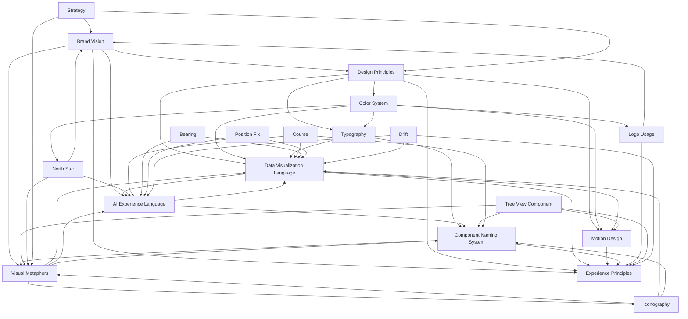

# Graph Relationships

## Concept graph

## Relationship types

- influences
- defines
- reinforces
- maps-to
- constrains
- uses
- derives-from
- supports

## Relationship summary

- Brand Vision influences all other design concepts.
- Design Principles constrain visual and interaction behavior.
- Visual Metaphors provide the core expression system.
- Color, typography, iconography, and motion make the metaphor legible and usable.
- Data Visualization Language translates strategic concept mapping into a charting layer.
- AI Experience Language translates generic AI behavior into navigation language.
- Component Naming System keeps the interface aligned with the metaphor at the architecture level.
- Experience Principles establish the user-facing intent that every design decision supports.
- Tree View Component standardizes hierarchical navigation and disclosure behavior across setup workflows.
